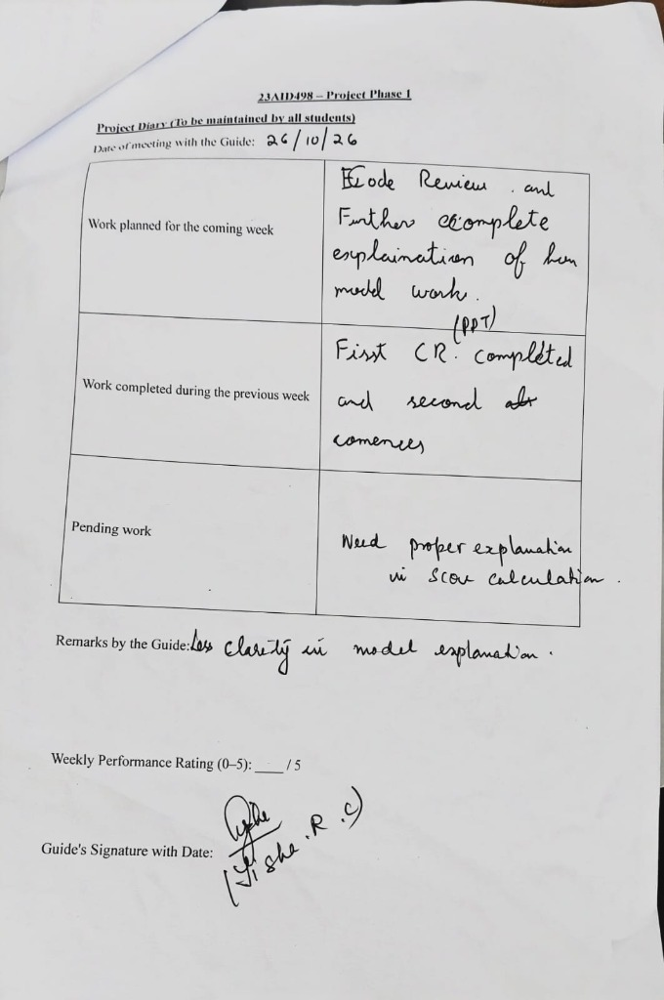

# Final Year Documents

## Course: 23AID498 — Project Phase I
**Document:** Project Diary (To be maintained by all students)  
**Date of Meeting with the Guide:** 26/10/26  

---

### Diary Entry (26/10/2026)

| Section | Entry |
|---|---|
| **Work planned for the coming week** | Code Review and Further complete explanation of how model works. (PPT) |
| **Work completed during the previous week** | First CR completed and second abr commences |
| **Pending work** | Need proper explanation in score calculation. |
| **Remarks by the Guide** | Less clarity in model explanation. |
| **Weekly Performance Rating (0–5)** | ___/5 |
| **Guide's Signature with Date** | Signed (Nisha. R. C) |

---

### Scanned Document

